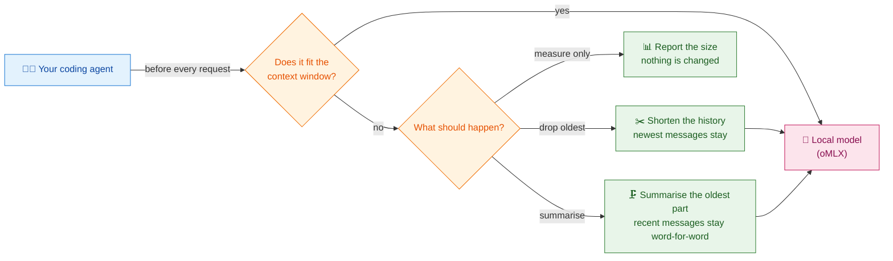

# Context Shrink


[](https://pypi.org/project/context-shrink-mcp/)


🌐 **English** · [Türkçe](./README.tr.md)

**Context Shrink** is a tiny MCP server that keeps requests to **any OpenAI-compatible endpoint** under the model's context limit. It measures the context before the call, then either **drops** the oldest messages or **compacts** them into a summary — instead of letting the server reject the request. It works with, among others:

- oMLX
- llama.cpp (`llama-server`)
- LM Studio
- vLLM
- the OpenAI API
- any OpenAI-compatible gateway

See [Compatible backends](#-compatible-backends) for the full list.

> **Token counting:** uses `tiktoken` when it is installed (`cl100k_base` by default) for a close approximation, and falls back to a tokenizer-free estimate (character count ÷ 4) otherwise. Either way it is a guard rail, not an exact budget — set `CONTEXT_SHRINK_TOKENIZER` (or the legacy `OMLX_SHRINK_*` / `OPENAI_SHRINK_*` names) to change the behaviour.

---

## 🔌 Compatible backends

The server only needs an **OpenAI-compatible `/v1/chat/completions` endpoint** —
local model servers, self-hosted GPU engines and OpenAI gateways all qualify.
Point it at the endpoint with `CONTEXT_SHRINK_BASE_URL` and `CONTEXT_SHRINK_MODEL`.
The wire protocol, headers and error shapes are summarised in
[`docs/reference/OPENAI-API-REFERENCE.md`](./docs/reference/OPENAI-API-REFERENCE.md).

### Quick config for the most common ones

| Backend | Base URL | Model value | Notes |
| :--- | :--- | :--- | :--- |
| oMLX | `http://127.0.0.1:8000/v1` | *(default)* | The original target |
| Ollama | `http://127.0.0.1:11434/v1` | e.g. `qwen2.5-coder` | No API key needed |
| llama.cpp (`llama-server`) | `http://127.0.0.1:8080/v1` | your GGUF name | CPU/GPU, lightweight |
| LM Studio | `http://127.0.0.1:1234/v1` | loaded model id | Works out of the box |
| vLLM | `http://127.0.0.1:8000/v1` | served model id | Production-grade, PagedAttention |
| Text Generation Inference (TGI) | `http://127.0.0.1:8080/v1` | served model id | HuggingFace, streaming |
| SGLang | `http://127.0.0.1:30000/v1` | served model id | High throughput |
| LocalAI | `http://127.0.0.1:8080/v1` | model name | Drop-in replacement |
| OpenAI / gateway | `https://api.openai.com/v1` | e.g. `gpt-4o-mini` | Set an API key |

Example with Ollama:

```bash
export CONTEXT_SHRINK_BASE_URL="http://127.0.0.1:11434/v1"
export CONTEXT_SHRINK_MODEL="qwen2.5-coder"
```

### ☁️ Remote / cloud OpenAI-compatible providers

Local is not the only option: every major provider exposes an OpenAI-compatible
`/v1/chat/completions` endpoint, so point the server at it and set
`CONTEXT_SHRINK_API_KEY`. All of these need a key or token.

- **OpenAI**
  - Base URL: https://api.openai.com/v1
  - Model: gpt-4o-mini
- **Azure OpenAI**
  - Base URL: https://{resource}.openai.azure.com/openai/deployments/{deployment}
  - Model: your deployment name
  - Uses the `api-key` header instead of `Authorization` — see below
- **DeepSeek**
  - Base URL: https://api.deepseek.com/v1
  - Model: deepseek-chat
- **Groq**
  - Base URL: https://api.groq.com/openai/v1
  - Model: llama-3.3-70b-versatile
  - Very fast
- **Together AI**
  - Base URL: https://api.together.xyz/v1
  - Model: meta-llama/Llama-3.3-70B-Instruct-Turbo
- **Fireworks AI**
  - Base URL: https://api.fireworks.ai/inference/v1
  - Model: accounts/fireworks/models/llama-v3p3-70b-instruct
- **Mistral API**
  - Base URL: https://api.mistral.ai/v1
  - Model: mistral-large-latest
- **OpenRouter**
  - Base URL: https://openrouter.ai/api/v1
  - Model: any model slug
  - Routes to 200+ models
- **HuggingFace Inference Endpoints**
  - Base URL: https://{your-endpoint}/v1
  - Model: your model
  - Private endpoint
- **Cloudflare Workers AI**
  - Base URL: https://api.cloudflare.com/client/v4/accounts/{account-id}/ai/v1
  - Model: @cf/meta/llama-3.3-70b-instruct-fp8

Azure OpenAI does not use a bearer `Authorization` header; pass its secret as a
custom header:

```bash
export CONTEXT_SHRINK_BASE_URL="https://myresource.openai.azure.com/openai/deployments/my-deployment"
export CONTEXT_SHRINK_MODEL="my-deployment"
export CONTEXT_SHRINK_EXTRA_HEADERS='{"api-key": "azure-secret"}'
```

Additional static headers for any gateway are accepted through
`CONTEXT_SHRINK_EXTRA_HEADERS` as a JSON object (for example an org id or a
custom routing header).

### Full catalogue

Anything below can serve as the summarisation endpoint; unlisted
OpenAI-compatible endpoints work too.

- **Local model servers:**
  - Ollama
  - llama.cpp (`llama-server`)
  - LM Studio
  - Jan
  - GPT4All (Python API)
  - llamafile (`--server`)
  - KoboldCpp
  - Oobabooga Text Generation WebUI (OpenAI extension)
  - MLC LLM
  - Petals (distributed)
- **GPU / production engines:**
  - vLLM
  - Aphrodite Engine (vLLM fork)
  - Text Generation Inference (TGI)
  - SGLang
  - NVIDIA NIM / TensorRT-LLM
  - ExLlamaV2 + TabbyAPI
  - Xinference
  - OpenLLM (BentoML)
  - FastChat (LMSYS)
  - LocalAI
- **Proxies & routers:**
  - LiteLLM (100+ providers)
  - OpenRouter
  - Portkey Gateway
  - One API / New API
  - community Ollama-to-OpenAI proxies
- **Libraries / custom stacks:**
  - `llama-cpp-python` (`llama_cpp.server`)
  - Transformers + FastAPI
  - AnythingLLM / Msty

---

## 📖 Overview

oMLX profiles for this class of models run **64K context** (`max_context_window: 65536`). That is a deliberate choice: with a 4-bit KV cache it keeps the runtime footprint at roughly 17–20 GB per model and keeps prefill short on Apple Silicon. Raising the limit is not free — every extra token of context is paid for in memory and prefill time.

The cost appears in a long session. Three things keep growing until the total
crosses the ceiling:

- the system prompt
- the conversation history
- the tool results

Once it crosses, the server refuses the whole request:

```text
Prompt is too long: 39514 tokens > 32768 maximum context length
```

At that point the agent stops. Nothing was wrong with the question — the prompt was simply 6.7K tokens too big. The usual workarounds are all unsatisfying:

| Workaround | Why it falls short |
| :--- | :--- |
| Raise `max_context_window` | Moves the wall, does not remove it; costs memory and prefill speed on the same machine |
| Truncate by hand | Manual, easy to forget, throws away whole sessions |
| Start a new session | Loses the context that made the task work in the first place |

So this server takes the cheap path: **keep 64K, send a smaller prompt.**

Read the full walkthrough (why 64K, the three compaction modes, the environment configuration, and the known limitations):

**[English →](./README.md)** · **[Türkçe →](./README.tr.md)**

---

## ✅ Recommendation

Use it if you run oMLX or another local OpenAI-compatible server with a fixed context window and you have hit `Prompt is too long` at least once. It is a single Python file and needs no GPU. `estimate_context` and `trim_context` are pure arithmetic — they cost nothing at inference time. `compact_context` only calls the local model when you ask it to summarise (or you can hand it a summary yourself and it calls nothing at all).

You probably do not need it if your context window is large enough for your sessions, or if your client already compacts history on its own.

---

## 🛠️ Tech Stack & Architecture

- **Language & Runtime:** Python 3.10+, standard library only
- **Protocol:** Model Context Protocol (MCP) over stdio transport
- **Client:** OpenCode (Code Mode groups tools under `tools.Context_Shrink.*`)
- **Compaction Engine:** Chunked summarisation via the local OpenAI-compatible endpoint
- **Token Counting:** optional `tiktoken` (default `cl100k_base`) with a character heuristic fallback — no hard dependency
- **Dependencies:** `mcp` (MCP SDK) required; `tiktoken` optional — no GPU
- **Target Server:** any OpenAI-compatible server — see [Compatible backends](#-compatible-backends)
- **Defaults:** `max_context_tokens = 32768`, `keep_last = 8`, `threshold = 0.8`

---

## ✨ Features

- 🧮 **Accurate-enough estimate** — `estimate_context` returns the estimated token count, the remaining budget and a `should_trim` flag
- ✂️ **Drop oldest messages** — `trim_context` returns the message list with the oldest messages removed, keeping the most recent `keep_last`
- 🧠 **Compact instead of drop** — `compact_context` replaces the oldest messages with a **summary**, keeping leading system messages and the most recent `keep_last` verbatim
- 📝 **Three compaction modes** — summary provided, model-generated, or plan-only (`needs_summary: true`, no message content echoed back)
- 🌐 **Optional real tokenizer** — uses `tiktoken` when installed, otherwise a tokenizer-free estimate (chars ÷ 4); `CONTEXT_SHRINK_TOKENIZER` controls the choice
- 🧾 **Configurable window** — set the context budget with `--max-context`, `CONTEXT_SHRINK_MAX_CONTEXT_TOKENS`, or a per-call argument; `describe_config` shows the active value and its source
- 🔌 **Plain MCP** — any MCP client can use the server, not just OpenCode
- 🧩 **Chunked summarisation** — long histories are summarised in pieces so the local model does not overflow while summarising
- 🔒 **No telemetry, no network calls** except the optional local summariser request

---

## 📸 Screenshots

_(No UI — this is a headless MCP server. Tool output is JSON on stdio.)_

---

## 🏗️ Architecture




---

### `compact_context` in three modes

1. **Summary provided** — pass `summary="..."` and no model call is made. Use
   this when the agent (or the user) already wrote the summary.
2. **Model-generated** — pass `model="..."` (and optionally `base_url`), or set
   the environment variables below, and the server summarises the oldest
   messages for you. Long histories are summarised in chunks so the local model
   does not overflow while summarising.
3. **Plan only** — with neither, the call returns `needs_summary: true`, the
   exact `summary_prompt` to use, and the token counts. **No message content is
   echoed back**, so the result stays small; call again with `summary=<text>`.
   Pass `model=""` to force this step even when the environment sets a model.

`compact_context` returns the assembled `messages` list only in modes 1 and 2,
and leaves the list untouched (`compacted: false`) when it is already within
`threshold` unless you pass `force: true`.

> **No model endpoint required:** modes 1 and 3 work without any
> `CONTEXT_SHRINK_*` variable. The environment variables only enable mode 2.

---

## 🚀 Installation & Quick Start

### Install (one line)

The package is on PyPI: [`context-shrink-mcp`](https://pypi.org/project/context-shrink-mcp/).

```bash
pip install context-shrink-mcp     # the package + the `context-shrink` command
```

Or skip the install and let `uvx` fetch and run it — no checkout, no manual copy
(install [`uv`](https://docs.astral.sh/uv/) once). Register the server with
OpenCode in one line:

```bash
# from PyPI
opencode mcp add context-shrink --global -- uvx --from context-shrink-mcp context-shrink

# or straight from GitHub (no package index needed)
opencode mcp add context-shrink --global -- uvx --from git+https://github.com/mahirfatih/context-shrink-mcp context-shrink
```

`uvx` resolves the `mcp` dependency in an isolated environment and runs the
server over stdio. Pin a version with `context-shrink-mcp@1.1.0` (PyPI) or
`…context-shrink-mcp@v1.1.0` (GitHub).

Enable model mode on the same command:

```bash
opencode mcp add context-shrink --global \
  --env CONTEXT_SHRINK_BASE_URL=http://127.0.0.1:8000/v1 \
  --env CONTEXT_SHRINK_MODEL=Qwen3.6-35B-A3B-4bit \
  --env CONTEXT_SHRINK_API_KEY=omlx-... \
  -- uvx --from context-shrink-mcp context-shrink
```

> Without `--global`, `opencode mcp add` writes to the project config
> (`./opencode.jsonc`) instead of `~/.config/opencode/opencode.jsonc`.

The numbered steps below are the repository-checkout path — use them to run the
file directly or from a dedicated virtualenv.

### 1. Prerequisites

| Requirement | Version / Notes |
| :--- | :--- |
| **Python** | 3.10+ (tested against `/opt/homebrew/bin/python3`) |
| **MCP SDK** | `pip install "mcp>=2.0"` |
| **Tokenizer** *(optional)* | `pip install tiktoken` for real token counting; falls back to chars ÷ 4 otherwise |
| **Client** | OpenCode (or any MCP client) |
| **Model server** | oMLX or another local OpenAI-compatible server (optional, for model mode) |

### 2. Install the SDK

```bash
pip install "mcp>=2.0"
```

### 3. Copy the server

Copy `context-shrink.py` into a directory of your choice (for example `~/.config/opencode/mcp/`). It is a single self-contained file — there is no package to install and no second module to keep in sync.

> **Note:** The `python3` in the `command` array may not be the one you expect —
> depending on your setup it could be `/opt/homebrew/bin/python3`, `/usr/bin/python3`,
> or somewhere else. Verify the path with `which python3` (or `which python`)
> and use the absolute path in the config instead of the bare `python3` if needed.

### 4. Register with OpenCode

Add the server to your OpenCode config (`~/.config/opencode/opencode.jsonc`):

```jsonc
{
  "mcp": {
    "servers": {
      "Context Shrink": {
        "type": "local",
        "command": [
          "python3",
          "/absolute/path/to/context-shrink.py"
        ],
        "timeout": 180000
      }
    }
  }
}
```

Config changes apply without a restart — OpenCode watches config files and reloads MCP servers after a save. To force a full reload, run `/reload`.

### Context window — the one setting most people change

Every tool compares the conversation against a context budget. It is resolved in
this order (first one wins):

1. the `max_context_tokens` argument of a tool call,
2. the `--max-context` command-line flag,
3. `CONTEXT_SHRINK_MAX_CONTEXT_TOKENS` (or its legacy aliases),
4. the built-in default, **`32768`**.

The default is deliberately small: when the window is unknown, trimming a little
too early is harmless, while assuming too much makes every request fail. Set it
to your server's real window when that is larger.

Both ways to set it live in the same OpenCode entry — pick one.

**Flag (`--max-context`):**

```jsonc
"command": [
  "python3",
  "/absolute/path/to/context-shrink.py",
  "--max-context", "65536"
]
```

**Environment variable:**

```jsonc
"environment": {
  "CONTEXT_SHRINK_MAX_CONTEXT_TOKENS": "65536"
}
```

`describe_config` reports the window every tool will use and where it came from
(`cli`, `env` or `default`).

### 5. (Optional) Enable model mode

Set the environment variables under `environment` in the MCP entry so `compact_context` can summarise with the local model. The values below are the ones this project was developed with — a local **oMLX** server on Apple Silicon, serving `Qwen3.6-35B-A3B-4bit`:

```jsonc
"environment": {
  "CONTEXT_SHRINK_MODEL": "Qwen3.6-35B-A3B-4bit",
  "CONTEXT_SHRINK_BASE_URL": "http://127.0.0.1:8000/v1",
  "CONTEXT_SHRINK_API_KEY": "omlx-...",
  "CONTEXT_SHRINK_TIMEOUT": "180",
  "CONTEXT_SHRINK_TOKENIZER": "auto"
}
```

### A real setup (this project's development machine)

This server was written for, and is used daily on, an Apple Silicon Mac driving a
local **oMLX** server — the 64K context profile it targets is documented in
[`mahirfatih/omlx-m1-max-benchmark`](https://github.com/mahirfatih/omlx-m1-max-benchmark).
On that machine OpenCode both **drives** the model and **runs** this server, so
two entries have to agree: the provider (the window OpenCode itself assumes) and
the MCP server (the window this server trims to).

**The provider — tell OpenCode the model's real window.** OpenCode plans its own
auto-compaction from `limit.context` and leaves reply head-room with
`limit.output`. Both must match the oMLX profile, or OpenCode misses the window in
one direction or the other:

```jsonc
{
  "provider": {
    "omlx": {
      "npm": "@ai-sdk/openai-compatible",
      "name": "oMLX (local)",
      "options": {
        "baseURL": "http://127.0.0.1:8000/v1",
        "apiKey": "omlx-..."
      },
      "models": {
        "Qwen3.6-35B-A3B-4bit": {
          "name": "Qwen3.6-35B-A3B-4bit",
          "limit": { "context": 65536, "output": 4096 }
        }
      }
    }
  }
}
```

- `limit.context: 65536` — the window OpenCode assumes. It must equal the oMLX
  `max_context_window`: a smaller value compacts too early, a larger one hands
  oMLX a prompt it answers with `Prompt is too long`.
- `limit.output: 4096` — the head-room OpenCode keeps for the reply when it
  decides the prompt is too big; it must not exceed the server's `max_tokens`.

**The MCP server — trim to the same number.** The entry runs the server from a
dedicated virtualenv, pins the window with `--max-context` so it cannot drift
from the provider block, and points the summariser at the local model:

```jsonc
{
  "mcp": {
    "servers": {
      "Context Shrink": {
        "type": "local",
        "command": [
          "/absolute/path/to/context-shrink-venv/bin/python",
          "/absolute/path/to/context-shrink.py",
          "--max-context", "65536"
        ],
        "environment": {
          "CONTEXT_SHRINK_MODEL": "Qwen3.6-35B-A3B-4bit",
          "CONTEXT_SHRINK_BASE_URL": "http://127.0.0.1:8000/v1",
          "CONTEXT_SHRINK_API_KEY": "omlx-...",
          "CONTEXT_SHRINK_TOKENIZER": "auto"
        },
        "timeout": 180000
      }
    }
  }
}
```

Keep the two numbers equal: `limit.context` in the provider block and
`--max-context` here. Without either, the server falls back to its built-in
`32768` (see [Context window](#context-window--the-one-setting-most-people-change));
`describe_config` prints what it actually resolved and from where.

> The `CONTEXT_SHRINK_API_KEY` is the token the local oMLX server expects; it is
> redacted here. Replace the paths and the key with your own.

### Configuration

`compact_context` reads its endpoint and model from the environment when the
arguments are not given.

The canonical names are `CONTEXT_SHRINK_*`. The legacy `OMLX_SHRINK_*` names and
the vendor-neutral `OPENAI_SHRINK_*` aliases are identical in meaning and are
used only when every higher-precedence name is unset. Precedence:

```text
CONTEXT_SHRINK_*  >  OMLX_SHRINK_* (legacy)  >  OPENAI_SHRINK_*
```

| Variable | Default | Meaning |
| :--- | :--- | :--- |
| `CONTEXT_SHRINK_BASE_URL` / `OMLX_SHRINK_BASE_URL` / `OPENAI_SHRINK_BASE_URL` | `http://127.0.0.1:8000/v1` | OpenAI-compatible base URL (a trailing `/chat/completions` is also accepted) |
| `CONTEXT_SHRINK_MODEL` / `OMLX_SHRINK_MODEL` / `OPENAI_SHRINK_MODEL` | *(empty)* | Model name to summarise with; empty disables the model mode |
| `CONTEXT_SHRINK_API_KEY` / `OMLX_SHRINK_API_KEY` / `OPENAI_SHRINK_API_KEY` | *(empty)* | Bearer token, if the server needs one |
| `CONTEXT_SHRINK_TIMEOUT` / `OMLX_SHRINK_TIMEOUT` / `OPENAI_SHRINK_TIMEOUT` | `180` | Summariser request timeout, seconds (invalid values fall back to 180) |
| `CONTEXT_SHRINK_TOKENIZER` / `OMLX_SHRINK_TOKENIZER` / `OPENAI_SHRINK_TOKENIZER` | `auto` | Token counter: `auto` (tiktoken `cl100k_base` if installed, else heuristic), a tiktoken encoding name, or `heuristic`/`off` to always use chars ÷ 4 |
| `CONTEXT_SHRINK_MAX_CONTEXT_TOKENS` / `OMLX_SHRINK_MAX_CONTEXT_TOKENS` / `OPENAI_SHRINK_MAX_CONTEXT_TOKENS` | `32768` | Default context budget for every tool call (the `--max-context` flag overrides it) |
| `CONTEXT_SHRINK_EXTRA_HEADERS` / `OMLX_SHRINK_EXTRA_HEADERS` / `OPENAI_SHRINK_EXTRA_HEADERS` | *(empty)* | Extra HTTP headers as a JSON object, for gateways such as Azure OpenAI (`{"api-key": "..."}`) |
| `CONTEXT_SHRINK_LOG_LEVEL` / `OMLX_SHRINK_LOG_LEVEL` / `OPENAI_SHRINK_LOG_LEVEL` | `INFO` | stderr log level (use `DEBUG` when troubleshooting); an invalid name falls back to `INFO` |

### Common pitfalls

- An **empty `CONTEXT_SHRINK_MODEL`** puts `compact_context` into plan-only mode:
  it returns a `needs_summary` plan instead of calling a model.
- A **too-small `max_context_tokens`** makes every call look over-budget; set it
  to the model's real context window (the default is `32768`).
- **`*_EXTRA_HEADERS` must be a JSON object** — a string, array or malformed JSON
  is ignored with a warning.
- A **remote/cloud `CONTEXT_SHRINK_BASE_URL`** forwards your messages to that
  endpoint; only point it at a server you trust.
- Out-of-range `max_context_tokens` values are clamped to `1…1000000` so a typo
  cannot exhaust memory.

### 6. Use it

- Call `estimate_context` with the current message list.
- If `should_trim` is `true`, call `trim_context` and send the returned list, or
  `compact_context` to keep the gist instead of dropping it.
- An agent can do this automatically before every request when the estimate
  crosses the limit.

Example `estimate_context` call:

```json
{
  "messages": [
    { "role": "user", "content": "first message" },
    { "role": "assistant", "content": "first answer" },
    { "role": "user", "content": "second message" }
  ],
  "max_context_tokens": 32768
}
```

Example `trim_context` call:

```json
{
  "messages": [ "..." ],
  "keep_last": 8,
  "max_context_tokens": 32768
}
```

Compaction flow, model mode:

```json
{
  "messages": [ "..." ],
  "keep_last": 8,
  "model": "Qwen3.6-35B-A3B-4bit",
  "base_url": "http://127.0.0.1:8000/v1"
}
```

Compaction flow, agent mode (two calls):

1. `compact_context({ "messages": [...], "force": true })` → `needs_summary: true`
   plus the `summary_prompt`.
2. The agent writes the summary, then calls again with
   `{ "messages": [...], "force": true, "summary": "<that text>" }` → the
   compacted `messages` list.

### Tool parameters

| Tool | Parameter | Default | Meaning |
| :--- | :--- | :--- | :--- |
| *(all)* | `messages` | *(required)* | Conversation as `role` / `content` pairs |
| `estimate_context` | `max_context_tokens` | `32768` | Budget to compare the estimate against |
| `trim_context` | `keep_last` | `8` | Newest messages always kept |
| `trim_context` | `max_context_tokens` | `32768` | Budget to trim down to |
| `compact_context` | `keep_last` | `8` | Newest messages kept verbatim |
| `compact_context` | `max_context_tokens` | `32768` | Context budget |
| `compact_context` | `threshold` | `0.8` | Compact only above this fraction of the budget (unless `force`) |
| `compact_context` | `force` | `false` | Compact even when under `threshold` |
| `compact_context` | `summary` | *(none)* | Pre-written summary (mode 1) |
| `compact_context` | `model` | *(env)* | Model for a generated summary (mode 2); `""` forces plan-only |
| `compact_context` | `base_url` | *(env)* | Endpoint override for the summariser |
| `compact_context` | `api_key` | *(env)* | Bearer token override for the summariser |
| `compact_context` | `summary_budget_tokens` | `512` | Upper bound for the generated summary |
| `compact_context` | `summary_role` | `"system"` | Role of the message that carries the summary |

`estimate_context` also returns a `tokenizer` field naming the counter in use
(for example `tiktoken:cl100k_base` or `heuristic(chars/4)`).

`describe_config` takes no parameters: it returns the resolved `base_url`,
`model`, `max_context_tokens` and its `max_context_source` (`cli`, `env` or
`default`), the tokenizer, and the policy defaults.

### Minimal clients

[`examples/python-client.py`](./examples/python-client.py) and
[`examples/js-client.js`](./examples/js-client.js) are runnable clients: each
starts the server over stdio, lists its tools and calls `estimate_context`.

```bash
python examples/python-client.py                          # uses ./context-shrink.py
python examples/python-client.py /path/to/context-shrink.py

cd examples && npm install && node js-client.js           # same client in Node
```

Run the Python client with the same interpreter that has `mcp` installed; the
Node client needs Node 18+ and `npm install` once.

---

## 📂 Project Structure

```
context-shrink-mcp/
├── context-shrink.py        # Single-file MCP server (the whole product)
├── pyproject.toml           # Packaging + the `context-shrink` console script
├── README.md                # English quick tour
├── README.tr.md             # Turkish quick tour
├── CONTRIBUTING.md          # Setup, tests, commit conventions
├── CHANGELOG.md             # Keep a Changelog release notes
├── docs/                    # Documentation tree (see docs/README.md)
│   ├── README.md            # Doc map
│   ├── guides/MIGRATION.md  # Rename / migration notes
│   ├── guides/RELEASING.md  # Version, build and publish steps
│   ├── reference/OPENAI-API-REFERENCE.md  # Endpoint, headers, errors
│   └── testing/TESTING.md   # Suites, runner, live tests
├── requirements.txt         # Runtime dependency (mcp)
├── requirements-dev.txt     # Dev dependencies (mcp, pytest, ruff, tiktoken)
├── pytest.ini               # pytest config (testpaths, python_files)
├── .ruff.toml               # Ruff lint configuration
├── .pre-commit-config.yaml  # Optional local git hooks
├── .github/workflows/ci.yml # CI: lint + compile + tests
├── test/                    # Test runner + suites
│   ├── test.sh              # Single test runner (ruff + pytest)
│   ├── README.md            # Test folder guide
│   ├── py/                  # Python suites
│   │   ├── context-shrink-tests.py       # Helpers, tokenizer, fixtures
│   │   ├── context-shrink-mcp-tests.py   # STDIO end-to-end round-trip
│   │   └── context-shrink-live-tests.py  # Live oMLX integration (opt-in)
│   └── js/                  # Node integration tests (MCP JS SDK)
├── examples/                # Runnable examples
│   ├── python-client.py     # Minimal MCP client: list tools + call one
│   └── js-client.js         # The same client in Node (MCP JS SDK)
├── LICENSE                  # MIT
└── .gitignore
```

---

## 🧪 Testing & CI

```bash
./test/test.sh              # install dev deps, then ruff + pytest
./test/test.sh --lint       # ruff only
./test/test.sh --no-install # skip the pip install step
./test/test.sh --only test/py/context-shrink-tests.py::test_compact_uses_provided_summary
```

- **Runner:** [`test/test.sh`](./test/test.sh) installs the dev dependencies, runs Ruff, then pytest. The interpreter is the project `.venv` when present, otherwise `python3`.
- **Suites:** [`test/py/context-shrink-tests.py`](./test/py/context-shrink-tests.py) covers the pure helpers (token estimation, trimming, compaction splitting and chunking), the tokenizer resolution logic and the env-var parsing — no network. [`test/py/context-shrink-mcp-tests.py`](./test/py/context-shrink-mcp-tests.py) adds an end-to-end round-trip over the real STDIO transport (handshake → `tools/list` → `tools/call`).
- **Live tests (opt-in):** [`test/py/context-shrink-live-tests.py`](./test/py/context-shrink-live-tests.py) and the Node suite in [`test/js/`](./test/js) hit a real endpoint. They are skipped unless `CONTEXT_SHRINK_LIVE=1` is set and the endpoint answers, so the default run stays offline. The API key is read from `CONTEXT_SHRINK_API_KEY`, never stored in the repo.
- **Details:** [`docs/testing/TESTING.md`](./docs/testing/TESTING.md) has the full suite map, flags and live-test setup.
- **Node tests:** `cd test/js && npm install && npm test` runs the protocol tests through the official MCP JS SDK; the model test is gated by the same `CONTEXT_SHRINK_LIVE` flag.
- **CI:** [`.github/workflows/ci.yml`](./.github/workflows/ci.yml) runs Ruff, a `py_compile` check, and `pytest`. It is **manual only** — trigger it with `workflow_dispatch` (Actions tab → CI → Run workflow).

Run the server by hand to exercise it through a client:

```bash
python3 context-shrink.py   # starts the stdio server; Ctrl-C to stop
```

---

## 📚 Documentation

- [README.md](./README.md) — this file.
- [README.tr.md](./README.tr.md) — Turkish translation.
- [context-shrink.py](./context-shrink.py) — source of truth for tool schemas and behaviour.
- [pyproject.toml](./pyproject.toml) — packaging and the `context-shrink` console script.
- [pypi.org/project/context-shrink-mcp](https://pypi.org/project/context-shrink-mcp/) — the published package.
- [CONTRIBUTING.md](./CONTRIBUTING.md) — development setup, tests, and commit conventions.
- [CHANGELOG.md](./CHANGELOG.md) — release notes.
- [docs/README.md](./docs/README.md) — the documentation map.
- [docs/reference/OPENAI-API-REFERENCE.md](./docs/reference/OPENAI-API-REFERENCE.md) — the endpoint, headers and error shapes this server relies on.
- [docs/testing/TESTING.md](./docs/testing/TESTING.md) — the suites, the runner and the opt-in live tests.
- [docs/guides/MIGRATION.md](./docs/guides/MIGRATION.md) — renaming from oMLX Prompt Shrink.
- [docs/guides/RELEASING.md](./docs/guides/RELEASING.md) — version, build and publish steps.
- [examples/python-client.py](./examples/python-client.py) — a runnable MCP client that lists the tools and calls one.
- [examples/js-client.js](./examples/js-client.js) — the same client in Node, built on the official MCP JS SDK.
- [MCP Python SDK](https://github.com/modelcontextprotocol/python-sdk) — the transport and `MCPServer` API this file is built on.

---

## 📝 Notes

- Default context limit: `32768` tokens — raise it with `--max-context` or `CONTEXT_SHRINK_MAX_CONTEXT_TOKENS` to match your profile.
- Trim policy: oldest messages first; the last `keep_last` messages are always kept.
- Compact policy: leading `system` messages are kept, the oldest of the rest are replaced by one `system` message holding the summary, and the last `keep_last` messages are kept verbatim.
- The tool surface is plain MCP, so any MCP client can use the server, not just OpenCode.

---

## 🔁 Migrating from oMLX Prompt Shrink

The project was renamed from **oMLX Prompt Shrink** to the vendor-neutral
**Context Shrink**; the tool names are unchanged and the old repository URL
redirects. The file path, tool namespace, repository and environment-variable
mapping is in [`docs/guides/MIGRATION.md`](./docs/guides/MIGRATION.md).

---

## 🔗 Background

The 64K profile and the `Prompt is too long` failure this server addresses are documented in [`mahirfatih/omlx-m1-max-benchmark`](https://github.com/mahirfatih/omlx-m1-max-benchmark): `docs/reference/PROFILES.md` explains why the context window is set to 64K, and the README has the recommendation section for this server.

---

## 🔐 Permissions & Privacy

| Setting / Key | Purpose | Location |
| :--- | :--- | :--- |
| `CONTEXT_SHRINK_BASE_URL` | OpenAI-compatible base URL | environment / argument |
| `CONTEXT_SHRINK_MODEL` | Model used for summarisation | environment / argument |
| `CONTEXT_SHRINK_API_KEY` | Bearer token for the local server | environment / argument |
| `CONTEXT_SHRINK_TIMEOUT` | Summariser request timeout (seconds) | environment |
| `CONTEXT_SHRINK_TOKENIZER` | Token counter selection (`auto` / encoding / `heuristic`) | environment |

> **Privacy:** The server makes **no network requests** of its own except the optional summariser call to the local OpenAI-compatible endpoint you configure. No telemetry, no analytics, no data leaves the machine. All state is in-memory for the duration of a tool call.

**Version:** `1.1.0`

---

## 📄 License

This project is licensed under the MIT License.
