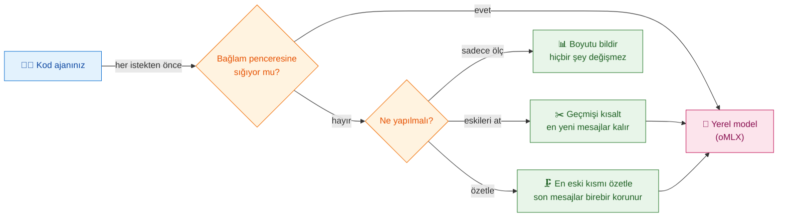

# Context Shrink


[](https://pypi.org/project/context-shrink-mcp/)


🌐 [English](./README.md) · **Türkçe**

**Context Shrink**, **OpenAI uyumlu herhangi bir uç noktaya** giden istekleri modelin bağlam (context) sınırının altında tutan küçük bir MCP sunucusudur. Çağrıdan önce bağlamı ölçer, ardından en eski mesajları ya **atar** ya da bir özete **sıkıştırır** — böylece sunucunun isteği reddetmesinin önüne geçer. Şunlarla çalışır (örnek):

- oMLX
- llama.cpp (`llama-server`)
- LM Studio
- vLLM
- OpenAI API'si
- OpenAI uyumlu herhangi bir ağ geçidi

Tam liste için [Uyumlu altyapılar](#-uyumlu-altyapılar) bölümüne bakın.

> **Token sayımı:** kuruluysa yakın bir tahmin için `tiktoken` kullanır (varsayılan `cl100k_base`), aksi hâlde tokenizer'sız bir tahmine (karakter sayısı ÷ 4) düşer. Her iki durumda da bu bir güvenlik bariyeridir, kesin bir bütçe değildir — davranışı değiştirmek için `CONTEXT_SHRINK_TOKENIZER` (veya eski `OMLX_SHRINK_*` / `OPENAI_SHRINK_*` adları) ayarlanır.

---

## 🔌 Uyumlu altyapılar

Sunucu yalnızca bir **OpenAI uyumlu `/v1/chat/completions` uç noktası** ister —
yerel model sunucuları, kendi GPU'unuzda çalışan motorlar ve OpenAI ağ geçitleri
hepsi uyar. `CONTEXT_SHRINK_BASE_URL` ve `CONTEXT_SHRINK_MODEL` ile yönlendirin.
Tel protokolü, başlıklar ve hata biçimleri
[`docs/reference/OPENAI-API-REFERENCE.md`](./docs/reference/OPENAI-API-REFERENCE.md) dosyasında özetlenmiştir.

### En yaygın olanlar için hızlı yapılandırma

| Altyapı | Base URL | Model değeri | Notlar |
| :--- | :--- | :--- | :--- |
| oMLX | `http://127.0.0.1:8000/v1` | *(varsayılan)* | Orijinal hedef |
| Ollama | `http://127.0.0.1:11434/v1` | örn. `qwen2.5-coder` | API anahtarı gerektirmez |
| llama.cpp (`llama-server`) | `http://127.0.0.1:8080/v1` | GGUF adınız | CPU/GPU, hafif |
| LM Studio | `http://127.0.0.1:1234/v1` | yüklenen model id'si | Kısayol gerekmez |
| vLLM | `http://127.0.0.1:8000/v1` | sunulan model id'si | Üretim için, PagedAttention |
| Text Generation Inference (TGI) | `http://127.0.0.1:8080/v1` | sunulan model id'si | HuggingFace, streaming |
| SGLang | `http://127.0.0.1:30000/v1` | sunulan model id'si | Yüksek verim |
| LocalAI | `http://127.0.0.1:8080/v1` | model adı | Drop-in replacement |
| OpenAI / ağ geçidi | `https://api.openai.com/v1` | örn. `gpt-4o-mini` | API anahtarı verin |

Ollama örneği:

```bash
export CONTEXT_SHRINK_BASE_URL="http://127.0.0.1:11434/v1"
export CONTEXT_SHRINK_MODEL="qwen2.5-coder"
```

### ☁️ Uzak / bulut OpenAI-uyumlu sağlayıcılar

Yerel tek seçenek değil: büyük sağlayıcıların hepsi OpenAI uyumlu bir
`/v1/chat/completions` uç noktası sunar. Sunucuyu ona yöneltin ve
`CONTEXT_SHRINK_API_KEY` verin. Hepsi bir anahtar ya da token ister.

- **OpenAI**
  - Base URL: https://api.openai.com/v1
  - Model: gpt-4o-mini
- **Azure OpenAI**
  - Base URL: https://{resource}.openai.azure.com/openai/deployments/{deployment}
  - Model: deployment adınız
  - `Authorization` yerine `api-key` başlığı kullanır — aşağıya bakın
- **DeepSeek**
  - Base URL: https://api.deepseek.com/v1
  - Model: deepseek-chat
- **Groq**
  - Base URL: https://api.groq.com/openai/v1
  - Model: llama-3.3-70b-versatile
  - Çok hızlı
- **Together AI**
  - Base URL: https://api.together.xyz/v1
  - Model: meta-llama/Llama-3.3-70B-Instruct-Turbo
- **Fireworks AI**
  - Base URL: https://api.fireworks.ai/inference/v1
  - Model: accounts/fireworks/models/llama-v3p3-70b-instruct
- **Mistral API**
  - Base URL: https://api.mistral.ai/v1
  - Model: mistral-large-latest
- **OpenRouter**
  - Base URL: https://openrouter.ai/api/v1
  - Model: model slug'ı
  - 200+ modele yönlendirir
- **HuggingFace Inference Endpoints**
  - Base URL: https://{endpoint'iniz}/v1
  - Model: modeliniz
  - Özel uç nokta
- **Cloudflare Workers AI**
  - Base URL: https://api.cloudflare.com/client/v4/accounts/{account-id}/ai/v1
  - Model: @cf/meta/llama-3.3-70b-instruct-fp8

Azure OpenAI bearer `Authorization` başlığı kullanmaz; gizli anahtarı özel
başlık olarak geçirin:

```bash
export CONTEXT_SHRINK_BASE_URL="https://myresource.openai.azure.com/openai/deployments/my-deployment"
export CONTEXT_SHRINK_MODEL="my-deployment"
export CONTEXT_SHRINK_EXTRA_HEADERS='{"api-key": "azure-secret"}'
```

Herhangi bir ağ geçidi için ek statik başlıklar `CONTEXT_SHRINK_EXTRA_HEADERS`
ile JSON nesnesi biçiminde kabul edilir (örneğin org id ya da özel yönlendirme
başlığı).

### Tam katalog

Aşağıdakilerin hepsi özetleme uç noktası olarak kullanılabilir; listelenmeyen
OpenAI uyumlu uç noktalar da çalışır.

- **Yerel model sunucuları:**
  - Ollama
  - llama.cpp (`llama-server`)
  - LM Studio
  - Jan
  - GPT4All (Python API)
  - llamafile (`--server`)
  - KoboldCpp
  - Oobabooga Text Generation WebUI (OpenAI eklentisi)
  - MLC LLM
  - Petals (dağıtık)
- **GPU / üretim motorları:**
  - vLLM
  - Aphrodite Engine (vLLM fork'u)
  - Text Generation Inference (TGI)
  - SGLang
  - NVIDIA NIM / TensorRT-LLM
  - ExLlamaV2 + TabbyAPI
  - Xinference
  - OpenLLM (BentoML)
  - FastChat (LMSYS)
  - LocalAI
- **Proxy'ler ve router'lar:**
  - LiteLLM (100+ sağlayıcı)
  - OpenRouter
  - Portkey Gateway
  - One API / New API
  - topluluk Ollama-to-OpenAI proxy'leri
- **Kütüphaneler / özel yapılar:**
  - `llama-cpp-python` (`llama_cpp.server`)
  - Transformers + FastAPI
  - AnythingLLM / Msty

---

## 📖 Genel Bakış

Bu sınıftaki modeller için oMLX profilleri **64K bağlam** (`max_context_window: 65536`) ile çalışır. Bu bilinçli bir tercihtir: 4-bit KV önbelleğiyle çalışma zamanı ayak izini model başına yaklaşık 17–20 GB'ta tutar ve Apple Silicon'da prefill'i kısa tutar. Sınırı yükseltmek bedavadır değildir — bağlamdaki her ek token, bellekte ve prefill süresinde ödenir.

Maliyet uzun bir oturumda ortaya çıkar. Toplam tavanı aşana kadar üç şey büyümeye devam eder:

- sistem promptu
- konuşma geçmişi
- araç sonuçları

Tavanı aştığında sunucu tüm isteği reddeder:

```text
Prompt is too long: 39514 tokens > 32768 maximum context length
```

Bu noktada ajan durur. Soruda yanlış bir şey yoktu — prompt yalnızca 6.7K token fazlaydı. Alışılmış çözüm yollarının hiçbiri tatmin edici değildir:

| Çözüm yolu | Neden yetersiz |
| :--- | :--- |
| `max_context_window` değerini yükseltmek | Duvarı kaydırır, kaldırmaz; aynı makinede bellek ve prefill hızına mal olur |
| Elle kırpmak | Manuel, unutması kolay, koca oturumları çöpe atar |
| Yeni bir oturum başlatmak | Görevi çalıştıran bağlamı kaybeder |

Bu yüzden sunucu ucuz yolu seçer: **64K'yı koru, daha küçük bir prompt gönder.**

Tam anlatımı okuyun (neden 64K, üç sıkıştırma modu, ortam değişkenleri ve bilinen sınırlamalar):

**[English →](./README.md)** · **[Türkçe →](./README.tr.md)**

---

## ✅ Öneri

Sabit bir bağlam penceresine sahip oMLX veya başka bir yerel OpenAI-uyumlu sunucu kullanıyorsanız ve en az bir kez `Prompt is too long` hatası aldıysanız kullanın. Tek bir Python dosyasıdır ve GPU gerektirmez. `estimate_context` ve `trim_context` saf aritmetiktir — çıkarım zamanında hiçbir maliyeti yoktur. `compact_context` yalnızca özetlemesini istediğinizde yerel modeli çağırır (ya da hazır bir özet verirsiniz ve hiçbir şey çağırmaz).

Bağlam pencereniz oturumlarınız için yeterince büyükse ya da istemciniz geçmişi kendi başına sıkıştırıyorsa muhtemelen buna ihtiyacınız yok.

---

## 🛠️ Teknoloji Yığını ve Mimari

- **Dil ve Çalışma Zamanı:** Python 3.10+, yalnızca standart kütüphane
- **Protokol:** Model Context Protocol (MCP), stdio taşıması üzerinden
- **İstemci:** OpenCode (Code Mode araçları `tools.Context_Shrink.*` altında gruplar)
- **Sıkıştırma Motoru:** Yerel OpenAI-uyumlu endpoint üzerinden parçalı (chunked) özetleme
- **Token Sayımı:** opsiyonel `tiktoken` (varsayılan `cl100k_base`), karakter tabanlı heuristic fallback — zorunlu bağımlılık yok
- **Bağımlılıklar:** `mcp` (MCP SDK) zorunlu; `tiktoken` opsiyonel — GPU gerekmez
- **Hedef Sunucu:** OpenAI uyumlu herhangi bir sunucu — bkz. [Uyumlu altyapılar](#-uyumlu-altyapılar)
- **Varsayılanlar:** `max_context_tokens = 65536`, `keep_last = 8`, `threshold = 0.8`

---

## ✨ Özellikler

- 🧮 **Yeterince doğru tahmin** — `estimate_context` tahmini token sayısını, kalan bütçeyi ve `should_trim` bayrağını döner
- ✂️ **En eski mesajları at** — `trim_context`, en eski mesajları çıkarılmış mesaj listesini döner; en yeni `keep_last` tanesini korur
- 🧠 **Atmak yerine sıkıştır** — `compact_context`, en eski mesajları bir **özetle** değiştirir; baştaki sistem mesajlarını ve en yeni `keep_last` tanesini aynen korur
- 📝 **Üç sıkıştırma modu** — özet verilmiş, modelle üretilmiş veya yalnızca plan (`needs_summary: true`, mesaj içeriği geri döndürülmez)
- 🌐 **Opsiyonel gerçek tokenizer** — kuruluysa `tiktoken`, aksi hâlde tokenizer'sız tahmin (karakter ÷ 4); seçimi `CONTEXT_SHRINK_TOKENIZER` belirler
- 🔌 **Sade MCP** — herhangi bir MCP istemcisi sunucuyu kullanabilir, yalnızca OpenCode değil
- 🧩 **Parçalı özetleme** — uzun geçmişler parça parça özetlenir, böylece yerel model özetlerken taşmaz
- 🔒 **Telemetri yok, ağ çağrısı yok** — opsiyonel yerel özetleyici isteği hariç

---

## 📸 Ekran Görüntüleri

_(Arayüz yok — bu başsız (headless) bir MCP sunucusudur. Araç çıktısı stdio üzerinden JSON'dur.)_

---

## 🏗️ Mimari



---

### `compact_context` üç modda

1. **Özet verilmiş** — `summary="..."` geçin, model çağrısı yapılmaz. Ajan (veya
   kullanıcı) özeti zaten yazdıysa bunu kullanın.
2. **Modelle üretilmiş** — `model="..."` (ve isteğe bağlı `base_url`) geçin ya da
   aşağıdaki ortam değişkenlerini ayarlayın; sunucu en eski mesajları sizin için
   özetler. Uzun geçmişler parça parça özetlenir, böylece yerel model özetlerken
   taşmaz.
3. **Yalnızca plan** — ikisi de yoksa çağrı `needs_summary: true`, kullanılacak tam
   `summary_prompt` ve token sayılarını döner. **Hiçbir mesaj içeriği geri
   döndürülmez**, bu yüzden sonuç küçük kalır; `summary=<metin>` ile tekrar
   çağırın. Ortam bir model tanımlasa bile bu adımı zorlamak için `model=""` geçin.

`compact_context` birleştirilmiş `messages` listesini yalnızca 1 ve 2. modlarda
döner ve tahmin `threshold` içindeyse, `force: true` geçmediğiniz sürece listeyi
değiştirmez (`compacted: false`).

> **Model endpoint'i gerekmez:** 1 ve 3. modlar hiçbir `CONTEXT_SHRINK_*` değişkeni
> olmadan çalışır. Ortam değişkenleri yalnızca 2. modu etkinleştirir.

---

## 🚀 Kurulum ve Hızlı Başlangıç

### Tek satır kurulum

Paket PyPI'de: [`context-shrink-mcp`](https://pypi.org/project/context-shrink-mcp/).

```bash
pip install context-shrink-mcp     # paket + `context-shrink` komutu
```

Ya da kurulumu atlayıp `uvx`'in çekip çalıştırmasına bırakın — depo (checkout) ve
elle kopyalama yok (bir kez [`uv`](https://docs.astral.sh/uv/) kurun). Sunucuyu
OpenCode'a tek satırda kaydedin:

```bash
# PyPI'den
opencode mcp add context-shrink --global -- uvx --from context-shrink-mcp context-shrink

# ya da doğrudan GitHub'dan (paket dizinine gerek yok)
opencode mcp add context-shrink --global -- uvx --from git+https://github.com/mahirfatih/context-shrink-mcp context-shrink
```

`uvx`, `mcp` bağımlılığını izole bir ortamda çözer ve sunucuyu stdio üzerinden
çalıştırır. Sürümü `context-shrink-mcp@1.0.0` (PyPI) veya
`…context-shrink-mcp@v1.0.0` (GitHub) ile sabitleyin.

Model modunu aynı komutta etkinleştirin:

```bash
opencode mcp add context-shrink --global \
  --env CONTEXT_SHRINK_BASE_URL=http://127.0.0.1:8000/v1 \
  --env CONTEXT_SHRINK_MODEL=Qwen3.6-35B-A3B-4bit \
  --env CONTEXT_SHRINK_API_KEY=omlx-... \
  -- uvx --from context-shrink-mcp context-shrink
```

> `--global` olmadan `opencode mcp add`, `~/.config/opencode/opencode.jsonc`
> yerine proje yapılandırmasına (`./opencode.jsonc`) yazar.

Aşağıdaki numaralı adımlar depo (checkout) yoludur — dosyayı doğrudan ya da özel
bir sanal ortamdan çalıştırmak için kullanın.

### 1. Gereksinimler

| Gereksinim | Sürüm / Notlar |
| :--- | :--- |
| **Python** | 3.10+ (`/opt/homebrew/bin/python3` ile test edildi) |
| **MCP SDK** | `pip install "mcp>=2.0"` |
| **Tokenizer** *(opsiyonel)* | Gerçek token sayımı için `pip install tiktoken`; aksi hâlde karakter ÷ 4'e düşer |
| **İstemci** | OpenCode (veya herhangi bir MCP istemcisi) |
| **Model sunucusu** | oMLX veya başka bir yerel OpenAI-uyumlu sunucu (opsiyonel, model modu için) |

### 2. SDK'yı kurun

```bash
pip install "mcp>=2.0"
```

### 3. Sunucuyu kopyalayın

`context_shrink.py` dosyasını seçtiğiniz bir dizine kopyalayın (örneğin `~/.config/opencode/mcp/`). Depo (checkout), kısa çizgili ada işaret eden mevcut kurulumlar için aynı modülü çalıştıran dört satırlık bir `context-shrink.py` shim'i de içerir.

> **Not:** `command` dizisindeki `python3` beklediğiniz yorumlayıcı olmayabilir —
> kurulumunuza göre `/opt/homebrew/bin/python3`, `/usr/bin/python3` veya başka bir
> yer olabilir. Yolu `which python3` (veya `which python`) ile doğrulayın ve
> gerekirse düz `python3` yerine mutlak yolu kullanın.

### 4. OpenCode'a kaydedin

Sunucuyu OpenCode yapılandırmanıza (`~/.config/opencode/opencode.jsonc`) ekleyin:

```jsonc
{
  "mcp": {
    "servers": {
      "Context Shrink": {
        "type": "local",
        "command": [
          "python3",
          "/absolute/path/to/context_shrink.py"
        ],
        "timeout": 180000
      }
    }
  }
}
```

Yapılandırma değişiklikleri yeniden başlatma gerektirmez — OpenCode yapılandırma dosyalarını izler ve kayıttan sonra MCP sunucularını yeniden yükler. Tam yeniden yükleme için `/reload` çalıştırın.

### 5. (Opsiyonel) Model modunu etkinleştirin

`compact_context` yerel modelle özetleyebilsin diye ortam değişkenlerini MCP girdisindeki `environment` altında ayarlayın. Aşağıdaki değerler bu projenin geliştirildiği kurulumdur — Apple Silicon üzerinde yerel bir **oMLX** sunucusu, `Qwen3.6-35B-A3B-4bit` modelini sunar:

```jsonc
"environment": {
  "CONTEXT_SHRINK_MODEL": "Qwen3.6-35B-A3B-4bit",
  "CONTEXT_SHRINK_BASE_URL": "http://127.0.0.1:8000/v1",
  "CONTEXT_SHRINK_API_KEY": "omlx-...",
  "CONTEXT_SHRINK_TIMEOUT": "180",
  "CONTEXT_SHRINK_TOKENIZER": "auto"
}
```

### Gerçek kurulum (bu projenin geliştirme makinesi)

Bu sunucu, Apple Silicon bir Mac'te yerel bir **oMLX** sunucusuyla geliştirildi ve
her gün bu kurulumda kullanılıyor — hedeflediği 64K bağlam profili
[`mahirfatih/omlx-m1-max-benchmark`](https://github.com/mahirfatih/omlx-m1-max-benchmark)
deposunda belgelenmiştir. Oradaki OpenCode girdisi, sunucuyu özel bir sanal ortam
(virtualenv) üzerinden çalıştırır ve özetleyiciyi yerel modele yöneltir:

```jsonc
{
  "mcp": {
    "servers": {
      "Context Shrink": {
        "type": "local",
        "command": [
          "/absolute/path/to/context-shrink-venv/bin/python",
          "/absolute/path/to/context_shrink.py"
        ],
        "environment": {
          "CONTEXT_SHRINK_MODEL": "Qwen3.6-35B-A3B-4bit",
          "CONTEXT_SHRINK_BASE_URL": "http://127.0.0.1:8000/v1",
          "CONTEXT_SHRINK_API_KEY": "omlx-...",
          "CONTEXT_SHRINK_TOKENIZER": "auto"
        },
        "timeout": 180000
      }
    }
  }
}
```

> `CONTEXT_SHRINK_API_KEY`, yerel oMLX sunucusunun beklediği token'dır; burada
> sansürlenmiştir. Yolları ve anahtarı kendi değerlerinizle değiştirin.

### Yapılandırma

`compact_context`, argümanlar verilmediğinde endpoint'ini ve modelini ortamdan okur:

Kanonik adlar `CONTEXT_SHRINK_*`'tır. Eski `OMLX_SHRINK_*` adları ve
tedarikçi-tarafsız `OPENAI_SHRINK_*` diğer adları aynı anlama gelir ve yalnızca
daha yüksek öncelikli bir ad ayarlı değilse kullanılır. Öncelik:

```text
CONTEXT_SHRINK_*  >  OMLX_SHRINK_* (eski)  >  OPENAI_SHRINK_*
```

| Değişken | Varsayılan | Anlamı |
| :--- | :--- | :--- |
| `CONTEXT_SHRINK_BASE_URL` / `OMLX_SHRINK_BASE_URL` / `OPENAI_SHRINK_BASE_URL` | `http://127.0.0.1:8000/v1` | OpenAI-uyumlu base URL (sonunda `/chat/completions` olan da kabul edilir) |
| `CONTEXT_SHRINK_MODEL` / `OMLX_SHRINK_MODEL` / `OPENAI_SHRINK_MODEL` | *(boş)* | Özetleme için kullanılacak model adı; boşsa model modu kapalıdır |
| `CONTEXT_SHRINK_API_KEY` / `OMLX_SHRINK_API_KEY` / `OPENAI_SHRINK_API_KEY` | *(boş)* | Sunucu gerektiriyorsa Bearer token |
| `CONTEXT_SHRINK_TIMEOUT` / `OMLX_SHRINK_TIMEOUT` / `OPENAI_SHRINK_TIMEOUT` | `180` | Özetleyici istek zaman aşımı, saniye (geçersiz değer 180'e düşer) |
| `CONTEXT_SHRINK_TOKENIZER` / `OMLX_SHRINK_TOKENIZER` / `OPENAI_SHRINK_TOKENIZER` | `auto` | Token sayacı: `auto` (kuruluysa tiktoken `cl100k_base`, yoksa heuristic), bir tiktoken encoding adı veya her zaman karakter ÷ 4 için `heuristic`/`off` |
| `CONTEXT_SHRINK_MAX_CONTEXT_TOKENS` / `OMLX_SHRINK_MAX_CONTEXT_TOKENS` / `OPENAI_SHRINK_MAX_CONTEXT_TOKENS` | `65536` | Her araç çağrısı için varsayılan bağlam bütçesi |
| `CONTEXT_SHRINK_EXTRA_HEADERS` / `OMLX_SHRINK_EXTRA_HEADERS` / `OPENAI_SHRINK_EXTRA_HEADERS` | *(boş)* | Azure OpenAI gibi ağ geçitleri için ek HTTP başlıkları, JSON nesnesi biçiminde (`{"api-key": "..."}`) |
| `CONTEXT_SHRINK_LOG_LEVEL` / `OMLX_SHRINK_LOG_LEVEL` / `OPENAI_SHRINK_LOG_LEVEL` | `INFO` | stderr günlük seviyesi (sorun giderirken `DEBUG`); geçersiz ad `INFO`'ya düşer |

### Sık yapılan hatalar

- **Boş `CONTEXT_SHRINK_MODEL`** `compact_context`'i yalnızca plan moduna alır:
  model çağırmak yerine bir `needs_summary` planı döner.
- **Çok küçük `max_context_tokens`** her çağrıyı bütçe aşımı gibi gösterir; modele
  gerçek bağlam penceresini verin (varsayılan `65536`).
- **`*_EXTRA_HEADERS` bir JSON nesnesi olmalıdır** — string, dizi veya bozuk JSON
  uyarıyla birlikte yok sayılır.
- **Uzak/bulut `CONTEXT_SHRINK_BASE_URL`** mesajlarınızı o uç noktaya gönderir;
  yalnızca güvendiğiniz bir sunucuyu gösterin.
- Aralık dışı `max_context_tokens` değerleri `1…1000000` aralığına kırpılır, böylece
  bir yazım hatası belleği tüketemez.

### 6. Kullanın

- Geçerli mesaj listesiyle `estimate_context` çağırın.
- `should_trim` `true` ise, `trim_context` çağırıp dönen listeyi gönderin ya da
  atmak yerine özü korumak için `compact_context` kullanın.
- Bir ajan, tahmin sınırı aştığında bunu her istekten önce otomatik yapabilir.

Örnek `estimate_context` çağrısı:

```json
{
  "messages": [
    { "role": "user", "content": "ilk mesaj" },
    { "role": "assistant", "content": "ilk yanıt" },
    { "role": "user", "content": "ikinci mesaj" }
  ],
  "max_context_tokens": 65536
}
```

Örnek `trim_context` çağrısı:

```json
{
  "messages": [ "..." ],
  "keep_last": 8,
  "max_context_tokens": 65536
}
```

Sıkıştırma akışı, model modu:

```json
{
  "messages": [ "..." ],
  "keep_last": 8,
  "model": "Qwen3.6-35B-A3B-4bit",
  "base_url": "http://127.0.0.1:8000/v1"
}
```

Sıkıştırma akışı, ajan modu (iki çağrı):

1. `compact_context({ "messages": [...], "force": true })` → `needs_summary: true`
   ve `summary_prompt`.
2. Ajan özeti yazar, ardından tekrar çağırır:
   `{ "messages": [...], "force": true, "summary": "<o metin>" }` → sıkıştırılmış
   `messages` listesi.

### Araç parametreleri

| Araç | Parametre | Varsayılan | Anlamı |
| :--- | :--- | :--- | :--- |
| *(hepsi)* | `messages` | *(zorunlu)* | `role` / `content` çiftlerinden oluşan konuşma |
| `estimate_context` | `max_context_tokens` | `65536` | Tahminin karşılaştırılacağı bütçe |
| `trim_context` | `keep_last` | `8` | Her zaman korunan en yeni mesaj sayısı |
| `trim_context` | `max_context_tokens` | `65536` | Kırpılacak hedef bütçe |
| `compact_context` | `keep_last` | `8` | Aynen korunan en yeni mesaj sayısı |
| `compact_context` | `max_context_tokens` | `65536` | Bağlam bütçesi |
| `compact_context` | `threshold` | `0.8` | Bütçenin bu oranının üzerinde sıkıştır (aksi hâlde `force` gerekir) |
| `compact_context` | `force` | `false` | `threshold` altında olsa bile sıkıştır |
| `compact_context` | `summary` | *(yok)* | Hazır özet (mod 1) |
| `compact_context` | `model` | *(ortam)* | Üretilen özet için model (mod 2); `""` yalnızca plan adımını zorlar |
| `compact_context` | `base_url` | *(ortam)* | Özetleyici için uç nokta geçersiz kılma |
| `compact_context` | `api_key` | *(ortam)* | Özetleyici için Bearer token geçersiz kılma |
| `compact_context` | `summary_budget_tokens` | `512` | Üretilen özet için üst sınır |
| `compact_context` | `summary_role` | `"system"` | Özeti taşıyan mesajın rolü |

`estimate_context` ayrıca kullanılan sayacı belirten bir `tokenizer` alanı döner
(örneğin `tiktoken:cl100k_base` veya `heuristic(chars/4)`).

### Minimal istemciler

[`examples/python-client.py`](./examples/python-client.py) ve
[`examples/js-client.js`](./examples/js-client.js) çalıştırılabilir istemcilerdir:
her biri sunucuyu stdio üzerinden başlatır, araçları listeler ve
`estimate_context` çağırır.

```bash
python examples/python-client.py                          # ./context_shrink.py kullanır
python examples/python-client.py /yol/context_shrink.py

cd examples && npm install && node js-client.js           # aynı istemcinin Node sürümü
```

Python istemcisini `mcp` kurulu olan aynı yorumlayıcıyla çalıştırın; Node istemcisi
Node 18+ ve bir kez `npm install` gerektirir.

---

## 📂 Proje Yapısı

```
context-shrink-mcp/
├── context_shrink.py        # Tek dosyalık MCP sunucusu (ürünün tamamı)
├── context-shrink.py        # Yukarıdaki modülü çalıştıran dört satırlık shim
├── pyproject.toml           # Paketleme + `context-shrink` konsol betiği
├── README.md                # İngilizce hızlı tur
├── README.tr.md             # Türkçe hızlı tur
├── CONTRIBUTING.md          # Kurulum, testler, commit kuralları
├── CHANGELOG.md             # Keep a Changelog sürüm notları
├── docs/                    # Dokümantasyon ağacı (bkz. docs/README.md)
│   ├── README.md            # Doküman haritası
│   ├── guides/MIGRATION.md  # Yeniden adlandırma / geçiş notları
│   ├── guides/RELEASING.md  # Sürüm, derleme ve yayın adımları
│   ├── reference/OPENAI-API-REFERENCE.md  # Uç nokta, başlıklar, hatalar
│   └── testing/TESTING.md   # Paketler, runner, canlı testler
├── requirements.txt         # Çalışma zamanı bağımlılığı (mcp)
├── requirements-dev.txt     # Geliştirme bağımlılıkları (mcp, pytest, ruff, tiktoken)
├── pytest.ini               # pytest yapılandırması (testpaths, python_files)
├── .ruff.toml               # Ruff lint yapılandırması
├── .pre-commit-config.yaml  # Opsiyonel yerel git hook'ları
├── .github/workflows/ci.yml # CI: lint + derleme + testler
├── test/                    # Test runner + paketler
│   ├── test.sh              # Tek test runner (ruff + pytest)
│   ├── README.md            # Test klasörü kılavuzu
│   ├── py/                  # Python paketleri
│   │   ├── context-shrink-tests.py       # Yardımcılar, tokenizer, fixture'lar
│   │   ├── context-shrink-mcp-tests.py   # STDIO uçtan uca tur
│   │   └── context-shrink-live-tests.py  # Canlı oMLX entegrasyonu (opt-in)
│   └── js/                  # Node entegrasyon testleri (MCP JS SDK)
├── examples/                # Çalıştırılabilir örnekler
│   ├── python-client.py     # Minimal MCP istemcisi: araçları listele + birini çağır
│   └── js-client.js         # Aynı istemcinin Node sürümü (MCP JS SDK)
├── LICENSE                  # MIT
└── .gitignore
```

---

## 🧪 Test ve CI

```bash
./test/test.sh              # dev bağımlılıkları kur, sonra ruff + pytest
./test/test.sh --lint       # yalnızca ruff
./test/test.sh --no-install # pip install adımını atla
./test/test.sh --only test/py/context-shrink-tests.py::test_compact_uses_provided_summary
```

- **Runner:** [`test/test.sh`](./test/test.sh) geliştirme bağımlılıklarını kurar, Ruff ve ardından pytest çalıştırır. Yorumlayıcı, varsa proje `.venv`'i, yoksa `python3`'tür.
- **Paketler:** [`test/py/context-shrink-tests.py`](./test/py/context-shrink-tests.py) saf yardımcıları (token tahmini, kırpma, sıkıştırma bölme ve parçalama), tokenizer çözümleme mantığını ve ortam değişkeni ayrıştırmayı kapsar — ağ yok. [`test/py/context-shrink-mcp-tests.py`](./test/py/context-shrink-mcp-tests.py) ise gerçek STDIO taşıması üzerinden uçtan uca bir tur ekler (el sıkışma → `tools/list` → `tools/call`).
- **Canlı testler (opt-in):** [`test/py/context-shrink-live-tests.py`](./test/py/context-shrink-live-tests.py) ve [`test/js/`](./test/js) içindeki Node paketi gerçek bir uç noktaya bağlanır. `CONTEXT_SHRINK_LIVE=1` ayarlanmadıkça ve uç nokta yanıt vermedikçe atlanır; böylece varsayılan çalıştırma çevrimdışı kalır. API anahtarı `CONTEXT_SHRINK_API_KEY` ortam değişkeninden okunur, repoya asla yazılmaz.
- **Ayrıntılar:** [`docs/testing/TESTING.md`](./docs/testing/TESTING.md) tam paket haritasını, bayrakları ve canlı test kurulumunu içerir.
- **Node testleri:** `cd test/js && npm install && npm test` protokol testlerini resmi MCP JS SDK üzerinden çalıştırır; model testi aynı `CONTEXT_SHRINK_LIVE` bayrağına bağlıdır.
- **CI:** [`.github/workflows/ci.yml`](./.github/workflows/ci.yml) Ruff, bir `py_compile` kontrolü ve `pytest` çalıştırır. **Yalnızca manuel** tetiklenir — Actions sekmesi → CI → Run workflow.

Sunucuyu elle, bir istemci üzerinden çalıştırmak için:

```bash
python3 context_shrink.py   # stdio sunucusunu başlatır; durdurmak için Ctrl-C
```

---

## 📚 Dokümantasyon

- [README.md](./README.md) — İngilizce sürüm.
- [README.tr.md](./README.tr.md) — bu dosya.
- [context_shrink.py](./context_shrink.py) — araç şemaları ve davranışın kaynağı.
- [pyproject.toml](./pyproject.toml) — paketleme ve `context-shrink` konsol betiği.
- [pypi.org/project/context-shrink-mcp](https://pypi.org/project/context-shrink-mcp/) — yayınlanan paket.
- [CONTRIBUTING.md](./CONTRIBUTING.md) — geliştirme kurulumu, testler ve commit kuralları.
- [CHANGELOG.md](./CHANGELOG.md) — sürüm notları.
- [docs/README.md](./docs/README.md) — dokümantasyon haritası.
- [docs/reference/OPENAI-API-REFERENCE.md](./docs/reference/OPENAI-API-REFERENCE.md) — sunucunun dayandığı uç nokta, başlıklar ve hata biçimleri.
- [docs/testing/TESTING.md](./docs/testing/TESTING.md) — paketler, runner ve opt-in canlı testler.
- [docs/guides/MIGRATION.md](./docs/guides/MIGRATION.md) — oMLX Prompt Shrink'tan geçiş.
- [docs/guides/RELEASING.md](./docs/guides/RELEASING.md) — sürüm, derleme ve yayın adımları.
- [examples/python-client.py](./examples/python-client.py) — araçları listeleyip birini çağıran çalıştırılabilir bir MCP istemcisi.
- [examples/js-client.js](./examples/js-client.js) — aynı istemcinin resmi MCP JS SDK ile yazılmış Node sürümü.
- [MCP Python SDK](https://github.com/modelcontextprotocol/python-sdk) — bu dosyanın üzerine kurulduğu taşıma katmanı ve `MCPServer` API'si.

---

## 📝 Notlar

- Varsayılan bağlam sınırı: `65536` token — profilinize göre değiştirin.
- Kırpma politikası: önce en eski mesajlar; son `keep_last` mesaj her zaman korunur.
- Sıkıştırma politikası: baştaki `system` mesajları korunur, geri kalanların en eskileri özeti taşıyan tek bir `system` mesajıyla değiştirilir ve son `keep_last` mesaj aynen korunur.
- Araç yüzeyi sade MCP'dir; yani yalnızca OpenCode değil, herhangi bir MCP istemcisi sunucuyu kullanabilir.

---

## 🔁 oMLX Prompt Shrink'tan geçiş

Proje, **oMLX Prompt Shrink** adından tedarikçi-tarafsız **Context Shrink** adına
taşındı; araç adları değişmedi ve eski depo URL'i yönlendirir. Dosya yolu, araç
ad alanı, depo ve ortam değişkeni eşlemesi
[`docs/guides/MIGRATION.md`](./docs/guides/MIGRATION.md) dosyasında.

---

## 🔗 Arka Plan

Bu sunucunun ele aldığı 64K profili ve `Prompt is too long` hatası [`mahirfatih/omlx-m1-max-benchmark`](https://github.com/mahirfatih/omlx-m1-max-benchmark) deposunda belgelenmiştir: `docs/reference/PROFILES.md` bağlam penceresinin neden 64K olduğunu açıklar, README ise bu sunucu için öneri bölümünü içerir.

---

## 🔐 İzinler ve Gizlilik

| Ayar / Anahtar | Amaç | Konum |
| :--- | :--- | :--- |
| `CONTEXT_SHRINK_BASE_URL` | OpenAI-uyumlu base URL | ortam / argüman |
| `CONTEXT_SHRINK_MODEL` | Özetleme için kullanılan model | ortam / argüman |
| `CONTEXT_SHRINK_API_KEY` | Yerel sunucu için Bearer token | ortam / argüman |
| `CONTEXT_SHRINK_TIMEOUT` | Özetleyici istek zaman aşımı (saniye) | ortam |
| `CONTEXT_SHRINK_TOKENIZER` | Token sayacı seçimi (`auto` / encoding / `heuristic`) | ortam |

> **Gizlilik:** Sunucu, yapılandırdığınız yerel OpenAI-uyumlu endpoint'e yapılan opsiyonel özetleyici çağrısı dışında **kendi başına hiçbir ağ isteği yapmaz**. Telemetri yok, analitik yok, hiçbir veri makineden çıkmaz. Tüm durum yalnızca bir araç çağrısı boyunca bellekte tutulur.

**Sürüm:** `1.0.0`

---

## 📄 Lisans

Bu proje MIT Lisansı ile lisanslanmıştır.
